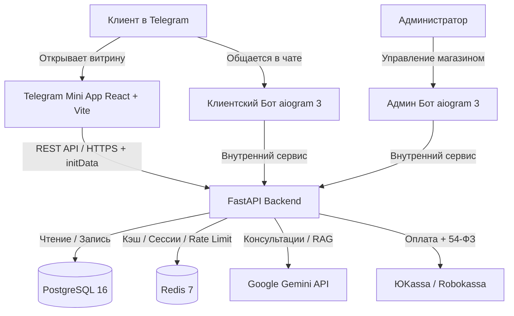

# Candela Home — Telegram Mini App & AI E-Commerce Ecosystem

## 1. Введение и концепция проекта

**Candela Home** — это омниканальная e-commerce система в экосистеме Telegram для бренда премиальной домашней парфюмерии:
* Ароматические свечи из натурального воска (соевый, кокосовый);
* Диффузоры с фибровыми палочками;
* Ароматические восковые саше для гардероба;
* Подарочные боксы и праздничные наборы.

### Архитектурная триада проекта:
1. **Telegram Mini App (TMA)** — главная витрина: каталог, мультимедиа-карточки товаров с ольфакторной пирамидой (верхние, средние и базовые ноты), корзина, выбор доставки и онлайн-оплата с фискализацией (54-ФЗ).
2. **Клиентский AI-бот (Candela Assistant)** — консультант («Арома-сомелье») на базе **Gemini API**: подбор ароматов под настроение, комнату или повод, ответы на вопросы по наличию, уведомления о статусах заказов.
3. **Административный бот (Candela Admin Hub)** — карманная CRM и аналитика: мониторинг выручки, обработка входящих заказов, смена статусов, ввод трек-номеров и пошаговый мастер добавления товаров с мобильного телефона.

---

## 2. Разделение ролей: Antigravity и Gemini

* **Antigravity**:
  * Проектирование архитектуры бэкенда (FastAPI, PostgreSQL, Redis, SQLAlchemy 2.0).
  * Реализация логики Telegram-ботов (клиентский + админский на aiogram 3).
  * Написание API и криптографической верификации `initData` Telegram.
  * Интеграция платёжного шлюза (ЮKassa/Продамус) и фискализации 54-ФЗ.
  * Сборка и связка фронтенда Mini App с бэкендом.
* **Gemini (Дизайн и промпт-инжиниринг)**:
  * Разработка UI/UX концептов для Telegram Mini App (эстетика «Тихая роскошь», пастельные тона, шрифтовые пары, эргономика мобильных карточек).
  * Генерация системных промптов для AI-консультанта («Арома-сомелье»).
  * Генерация описаний ароматов, маркетинговых текстов и ольфакторных пирамид.

---

## 3. Рекомендуемый технологический стек



* **Frontend Mini App**: React 18 / Vite, TypeScript, TailwindCSS, `@telegram-apps/sdk-react` (или нативный `window.Telegram.WebApp`), Lucide Icons.
* **Backend**: Python 3.11+, FastAPI, Pydantic v2, SQLAlchemy 2.0 (asyncio + asyncpg), Alembic.
* **Bots Engine**: aiogram 3.x (FSM, Router, фильтры).
* **Базы данных**: PostgreSQL 16 (основное хранилище), Redis 7 (кэширование, очереди, FSM-состояния ботов).
* **AI Core**: Google GenAI SDK (`google-genai`), модель `gemini-2.5-flash` (высокая скорость и точность в классификации запросов).
* **Платежи и фискализация**: ЮKassa API v3 (с фискализацией 54-ФЗ) / Prodamus.
* **DevOps**: Docker, Docker Compose, Nginx (Reverse Proxy + SSL Let's Encrypt).

---

## 4. Структура проекта в файловой системе

```text
TG_BOTS/
├── INSTRUCTIONS/                          # Модульные руководства для ИИ-агента и разработчика
│   ├── 00_PROJECT_OVERVIEW_AND_ROADMAP.md # Текущий обзор и карта проекта
│   ├── 01_LEGAL_AND_COMPLIANCE_RU.md      # Законы РФ: 152-ФЗ, 54-ФЗ, ЗоЗПП, Оферта
│   ├── 02_SECURITY_AND_AUTHENTICATION.md  # initData HMAC-SHA256, вебхуки, безопасность
│   ├── 03_DATABASE_AND_DATA_MODELS.md     # Схема БД PostgreSQL + SQLAlchemy модели
│   ├── 04_BACKEND_API_ARCHITECTURE.md     # Архитектура FastAPI эндпоинтов
│   ├── 05_TELEGRAM_MINI_APP_FRONTEND.md   # Структура и логика React Mini App
│   ├── 06_AI_CONSULTANT_BOT.md            # AI-консультант «Арома-сомелье» на Gemini
│   ├── 07_ADMIN_MANAGEMENT_BOT.md         # Бот управления: товары, заказы, выручка
│   ├── 08_PAYMENTS_AND_FISCALIZATION.md   # Эквайринг, 54-ФЗ, чеки и вебхуки
│   └── 09_DEPLOYMENT_DEVOPS_CHECKLIST.md  # Развертывание VPS, Docker, SSL, Nginx
│
└── Candela_Home/                          # Исходный код проекта
    ├── backend/                           # FastAPI сервис и бизнес-логика
    │   ├── app/
    │   │   ├── api/                       # Маршруты (v1/catalog, v1/orders, v1/payments)
    │   │   ├── core/                      # Конфиг (.env), безопасность, initData validator
    │   │   ├── db/                        # Модели SQLAlchemy, сессии, миграции
    │   │   ├── services/                  # Логика заказов, платежей, Gemini AI RAG
    │   │   └── main.py                    # Точка входа FastAPI
    │   ├── requirements.txt
    │   └── Dockerfile
    ├── bot_client/                        # Клиентский бот (aiogram 3 + AI-консультант)
    ├── bot_admin/                         # Административный бот-CRM (aiogram 3)
    ├── frontend_miniapp/                  # React + Vite Telegram Mini App
    ├── docker-compose.yml                 # Мультиконтейнерная сборка
    └── .env.example                       # Шаблон всех переменных окружения
```

---

## 5. Пошаговая дорожная карта реализации (Roadmap)

### Этап 1: Правовая база и архитектурная подготовка
- [ ] Оформление юридического статуса (Самозанятый / ИП на УСН 6% или Патент).
- [ ] Подготовка текста Публичной оферты и Политики обработки персональных данных (152-ФЗ).
- [ ] Регистрация и получение токенов ботов в `@BotFather` (Клиентский и Админский).
- [ ] Заключение договора с эквайрингом (ЮKassa / Prodamus) с подключением онлайн-кассы (54-ФЗ).

### Этап 2: База данных и ядро бэкенда (Antigravity)
- [ ] Настройка базы данных PostgreSQL и моделей каталога (товары, категории, ароматические пирамиды, остатки).
- [ ] Реализация криптографической верификации Telegram `initData`.
- [ ] Создание REST API каталога, корзины и оформления заказов на FastAPI.

### Этап 3: Frontend Telegram Mini App (Antigravity + дизайн Gemini)
- [ ] Создание React-проекта с поддержкой Telegram WebApp SDK и адаптивной темы.
- [ ] Верстка компонентов: Каталог, Фильтры по категориям/нотам, Карточка товара, Корзина.
- [ ] Реализация чекаута: выбор доставки (СДЭК/Почта/Курьер), ввод адреса, согласие с 152-ФЗ.
- [ ] Интеграция кнопки оплаты и переход в платёжный шлюз.

### Этап 4: Интеграция платежей и фискализации
- [ ] Интеграция API ЮKassa для создания счетов.
- [ ] Создание безопасного эндпоинта для приёма вебхуков об успешной оплате.
- [ ] Автоматическая отправка чеков покупателю (54-ФЗ) через облачную кассу эквайера.

### Этап 5: Административный бот-CRM (aiogram 3)
- [ ] Авторизация администраторов по белому списку `ADMIN_TELEGRAM_IDS`.
- [ ] Пошаговый FSM-мастер добавления товаров с фото, ценой и нотами ароматов.
- [ ] Панель заказов: просмотр состава, перевод статусов, ввод трек-номера.
- [ ] Мониторинг выручки: отчеты за день, неделю, месяц.
- [ ] Уведомления о новых отзывах с кнопкой «Ответить от лица компании» и быстрой модерацией.

### Этап 6: Программа лояльности, Личный кабинет и Отзывы
- [ ] Трёхуровневая система кэшбэка (5% Bronze / 10% Silver / 15% Gold) с оплатой бонусами до 100%.
- [ ] Личный кабинет пользователя в Mini App: баланс бонусов, прогресс уровней, история заказов.
- [ ] Модуль честных отзывов (звёзды, соответствие описанию, стойкость, плюсы/минусы, фото).
- [ ] Механизм резервирования остатков на складе (Redis Stock Locking на 15 мин при переходе к оплате).

### Этап 7: Интеллектуальный AI-консультант (Gemini)
- [ ] Настройка системного промпта «Арома-сомелье Candela».
- [ ] Интеграция RAG (поиск актуальных товаров из каталога по нотам и описанию).
- [ ] Бесшовный переход из диалога с ботом в карточку товара в Mini App.

### Этап 8: Безопасность, тестирование и деплой
- [ ] Аудит безопасности: защита от Replay-атак, проверка сигнатур вебхуков, Rate Limiting.
- [ ] Настройка VPS, Nginx, HTTPS-сертификатов Let's Encrypt.
- [ ] Тестовые платежи и проверка фискализации.
- [ ] Финальный запуск и публикация в Telegram.

---

## 6. Как использовать данные инструкции

Каждый файл в папке `INSTRUCTIONS/` самодостаточен:
* При работе над бэкендом загрузите `02_SECURITY_AND_AUTHENTICATION.md`, `03_DATABASE_AND_DATA_MODELS.md` и `04_BACKEND_API_ARCHITECTURE.md`.
* При верстке интерфейса используйте `05_TELEGRAM_MINI_APP_FRONTEND.md`.
* При реализации лояльности, профиля и отзывов используйте `10_LOYALTY_REVIEWS_AND_PROFILE.md`.
* При настройке бота-помощника читайте `06_AI_CONSULTANT_BOT.md`.
* При сборке админской панели передайте агенту `07_ADMIN_MANAGEMENT_BOT.md`.
* При подключении кассы и эквайринга опирайтесь на `01_LEGAL_AND_COMPLIANCE_RU.md` и `08_PAYMENTS_AND_FISCALIZATION.md`.
