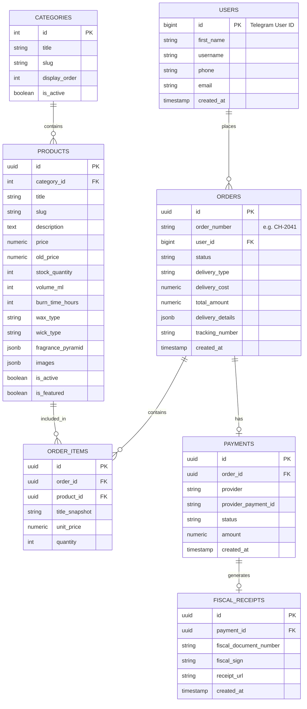

# База данных и модели данных (PostgreSQL + SQLAlchemy 2.0)

В этом документе представлена структура базы данных для магазина **Candela Home** с учетом специфики парфюмерных товаров (пирамида ароматов, время горения, тип воска), фискализации 54-ФЗ и безопасности заказов.

---

## 1. Диаграмма сущностей (ERD)



---

## 2. Модели данных SQLAlchemy 2.0 (Асинхронные)

Файл: `backend/app/db/models.py`

```python
import uuid
from datetime import datetime
from decimal import Decimal
from typing import List, Optional
from sqlalchemy import (
    BigInteger,
    Boolean,
    DateTime,
    Enum,
    ForeignKey,
    Integer,
    Numeric,
    String,
    Text,
    func
)
from sqlalchemy.dialects.postgresql import JSONB, UUID
from sqlalchemy.orm import DeclarativeBase, Mapped, mapped_column, relationship
import enum


class Base(DeclarativeBase):
    pass


class OrderStatus(str, enum.Enum):
    PENDING_PAYMENT = "pending_payment"  # Ожидает оплаты
    PAID = "paid"                        # Оплачен, ожидает сборки
    IN_PROCESSING = "in_processing"      # В процессе сборки
    SHIPPED = "shipped"                  # Передан в службу доставки
    DELIVERED = "delivered"              # Доставлен покупателю
    CANCELLED = "cancelled"              # Отменен
    REFUNDED = "refunded"                # Возврат средств


class DeliveryType(str, enum.Enum):
    CDEK_PVZ = "cdek_pvz"                # СДЭК пункт выдачи
    CDEK_COURIER = "cdek_courier"        # СДЭК курьер до двери
    POCHTA_RUSSIA = "pochta_russia"      # Почта России
    SELF_PICKUP = "self_pickup"          # Самовывоз из мастерской


class Category(Base):
    __tablename__ = "categories"

    id: Mapped[int] = mapped_column(Integer, primary_key=True, autoincrement=True)
    title: Mapped[str] = mapped_column(String(100), nullable=False)
    slug: Mapped[str] = mapped_column(String(100), unique=True, index=True, nullable=False)
    display_order: Mapped[int] = mapped_column(Integer, default=0)
    is_active: Mapped[bool] = mapped_column(Boolean, default=True)

    products: Mapped[List["Product"]] = relationship("Product", back_populates="category")


class Product(Base):
    __tablename__ = "products"

    id: Mapped[uuid.UUID] = mapped_column(UUID(as_uuid=True), primary_key=True, default=uuid.uuid4)
    category_id: Mapped[int] = mapped_column(ForeignKey("categories.id", ondelete="RESTRICT"), nullable=False)
    title: Mapped[str] = mapped_column(String(200), nullable=False)
    slug: Mapped[str] = mapped_column(String(200), unique=True, index=True, nullable=False)
    description: Mapped[str] = mapped_column(Text, nullable=False)

    price: Mapped[Decimal] = mapped_column(Numeric(10, 2), nullable=False)
    old_price: Mapped[Optional[Decimal]] = mapped_column(Numeric(10, 2), nullable=True)
    stock_quantity: Mapped[int] = mapped_column(Integer, default=0, nullable=False)

    # Специфика свечей и диффузоров
    volume_ml: Mapped[Optional[int]] = mapped_column(Integer, nullable=True) # Объем (например, 200 мл)
    burn_time_hours: Mapped[Optional[int]] = mapped_column(Integer, nullable=True) # Время горения (например, 45 ч)
    wax_type: Mapped[Optional[str]] = mapped_column(String(100), nullable=True) # "100% соевый воск"
    wick_type: Mapped[Optional[str]] = mapped_column(String(100), nullable=True) # "Деревянный фитиль с эффектом потрескивания"

    # Пирамида аромата в формате JSONB:
    # {"top": ["Бергамот", "Розовый перец"], "heart": ["Табачный лист", "Гвоздика"], "base": ["Ваниль", "Бобы тонка"]}
    fragrance_pyramid: Mapped[dict] = mapped_column(JSONB, default=dict, nullable=False)

    # Список URL фотографий: ["https://.../img1.jpg", "https://.../img2.jpg"]
    images: Mapped[list] = mapped_column(JSONB, default=list, nullable=False)

    is_active: Mapped[bool] = mapped_column(Boolean, default=True, index=True)
    is_featured: Mapped[bool] = mapped_column(Boolean, default=False)
    created_at: Mapped[datetime] = mapped_column(DateTime(timezone=True), server_default=func.now())

    category: Mapped["Category"] = relationship("Category", back_populates="products")
    order_items: Mapped[List["OrderItem"]] = relationship("OrderItem", back_populates="product")


class User(Base):
    __tablename__ = "users"

    # Telegram User ID хранится как первичный ключ
    id: Mapped[int] = mapped_column(BigInteger, primary_key=True, autoincrement=False)
    first_name: Mapped[str] = mapped_column(String(150), nullable=False)
    last_name: Mapped[Optional[str]] = mapped_column(String(150), nullable=True)
    username: Mapped[Optional[str]] = mapped_column(String(100), nullable=True, index=True)
    phone: Mapped[Optional[str]] = mapped_column(String(30), nullable=True)
    email: Mapped[Optional[str]] = mapped_column(String(255), nullable=True)
    created_at: Mapped[datetime] = mapped_column(DateTime(timezone=True), server_default=func.now())

    orders: Mapped[List["Order"]] = relationship("Order", back_populates="user")


class Order(Base):
    __tablename__ = "orders"

    id: Mapped[uuid.UUID] = mapped_column(UUID(as_uuid=True), primary_key=True, default=uuid.uuid4)
    order_number: Mapped[str] = mapped_column(String(20), unique=True, index=True, nullable=False) # e.g. "CH-1054"
    user_id: Mapped[int] = mapped_column(BigInteger, ForeignKey("users.id"), nullable=False)

    status: Mapped[OrderStatus] = mapped_column(
        Enum(OrderStatus), 
        default=OrderStatus.PENDING_PAYMENT, 
        nullable=False, 
        index=True
    )
    delivery_type: Mapped[DeliveryType] = mapped_column(Enum(DeliveryType), nullable=False)
    delivery_cost: Mapped[Decimal] = mapped_column(Numeric(10, 2), default=Decimal("0.00"), nullable=False)
    total_amount: Mapped[Decimal] = mapped_column(Numeric(10, 2), nullable=False)

    # Детали доставки: ФИО получателя, телефон, город, адрес ПВЗ или квартиры
    delivery_details: Mapped[dict] = mapped_column(JSONB, nullable=False)
    tracking_number: Mapped[Optional[str]] = mapped_column(String(100), nullable=True)

    created_at: Mapped[datetime] = mapped_column(DateTime(timezone=True), server_default=func.now())
    updated_at: Mapped[datetime] = mapped_column(DateTime(timezone=True), server_default=func.now(), onupdate=func.now())

    user: Mapped["User"] = relationship("User", back_populates="orders")
    items: Mapped[List["OrderItem"]] = relationship("OrderItem", back_populates="order", cascade="all, delete-orphan")
    payment: Mapped[Optional["Payment"]] = relationship("Payment", back_populates="order", uselist=False)


class OrderItem(Base):
    __tablename__ = "order_items"

    id: Mapped[uuid.UUID] = mapped_column(UUID(as_uuid=True), primary_key=True, default=uuid.uuid4)
    order_id: Mapped[uuid.UUID] = mapped_column(ForeignKey("orders.id", ondelete="CASCADE"), nullable=False)
    product_id: Mapped[uuid.UUID] = mapped_column(ForeignKey("products.id", ondelete="RESTRICT"), nullable=False)

    title_snapshot: Mapped[str] = mapped_column(String(200), nullable=False) # Сохраняем имя на момент покупки
    unit_price: Mapped[Decimal] = mapped_column(Numeric(10, 2), nullable=False)
    quantity: Mapped[int] = mapped_column(Integer, nullable=False)

    order: Mapped["Order"] = relationship("Order", back_populates="items")
    product: Mapped["Product"] = relationship("Product", back_populates="order_items")


class Payment(Base):
    __tablename__ = "payments"

    id: Mapped[uuid.UUID] = mapped_column(UUID(as_uuid=True), primary_key=True, default=uuid.uuid4)
    order_id: Mapped[uuid.UUID] = mapped_column(ForeignKey("orders.id"), unique=True, nullable=False)
    provider: Mapped[str] = mapped_column(String(50), nullable=False) # "yookassa" / "prodamus"
    provider_payment_id: Mapped[str] = mapped_column(String(100), unique=True, index=True, nullable=False)
    status: Mapped[str] = mapped_column(String(50), nullable=False)
    amount: Mapped[Decimal] = mapped_column(Numeric(10, 2), nullable=False)
    created_at: Mapped[datetime] = mapped_column(DateTime(timezone=True), server_default=func.now())

    order: Mapped["Order"] = relationship("Order", back_populates="payment")
    receipt: Mapped[Optional["FiscalReceipt"]] = relationship("FiscalReceipt", back_populates="payment", uselist=False)


class FiscalReceipt(Base):
    __tablename__ = "fiscal_receipts"

    id: Mapped[uuid.UUID] = mapped_column(UUID(as_uuid=True), primary_key=True, default=uuid.uuid4)
    payment_id: Mapped[uuid.UUID] = mapped_column(ForeignKey("payments.id"), unique=True, nullable=False)
    fiscal_document_number: Mapped[Optional[str]] = mapped_column(String(100), nullable=True)
    fiscal_sign: Mapped[Optional[str]] = mapped_column(String(100), nullable=True)
    receipt_url: Mapped[Optional[str]] = mapped_column(String(500), nullable=True)
    created_at: Mapped[datetime] = mapped_column(DateTime(timezone=True), server_default=func.now())

    payment: Mapped["Payment"] = relationship("Payment", back_populates="receipt")
```

---

## 3. Генерация номеров заказов

Для удобной коммуникации с клиентами и службами доставки вместо UUID используется короткий строковый формат номера заказа: `CH-XXXX` (например, `CH-1001`).

```python
# app/services/order_number.py
import random
import string
from sqlalchemy.ext.asyncio import AsyncSession
from sqlalchemy import select
from app.db.models import Order

async def generate_order_number(session: AsyncSession) -> str:
    """Генерация уникального читаемого номера заказа CH-1025"""
    while True:
        num = random.randint(1000, 99999)
        candidate = f"CH-{num}"
        result = await session.execute(select(Order.id).where(Order.order_number == candidate))
        if result.scalar_one_or_none() is None:
            return candidate
```

---

## 4. Модели отзывов и программы лояльности (Reviews & Loyalty)

### Модель отзыва на товар (Review)
```python
class Review(Base):
    __tablename__ = "reviews"

    id: Mapped[uuid.UUID] = mapped_column(UUID(as_uuid=True), primary_key=True, default=uuid.uuid4)
    user_id: Mapped[uuid.UUID] = mapped_column(ForeignKey("users.id", ondelete="CASCADE"), nullable=False)
    product_id: Mapped[uuid.UUID] = mapped_column(ForeignKey("products.id", ondelete="CASCADE"), nullable=False)
    order_id: Mapped[uuid.UUID] = mapped_column(ForeignKey("orders.id", ondelete="SET NULL"), nullable=True)

    rating: Mapped[int] = mapped_column(Integer, nullable=False) # 1..5
    is_as_described: Mapped[bool] = mapped_column(Boolean, default=True) # Соответствует описанию
    scent_intensity: Mapped[Optional[str]] = mapped_column(String(50), nullable=True) # Мягкий / Средний / Стойкий
    packaging_rating: Mapped[Optional[str]] = mapped_column(String(50), nullable=True) # Подарочная / Стандартная

    pros: Mapped[Optional[str]] = mapped_column(Text, nullable=True) # Плюсы
    cons: Mapped[Optional[str]] = mapped_column(Text, nullable=True) # Минусы
    comment: Mapped[Optional[str]] = mapped_column(Text, nullable=True)
    photos: Mapped[Optional[list[str]]] = mapped_column(JSONB, nullable=True)

    company_reply: Mapped[Optional[str]] = mapped_column(Text, nullable=True) # Ответ от лица компании
    replied_at: Mapped[Optional[datetime]] = mapped_column(DateTime(timezone=True), nullable=True)

    is_visible: Mapped[bool] = mapped_column(Boolean, default=True)
    created_at: Mapped[datetime] = mapped_column(DateTime(timezone=True), server_default=func.now())
```

### Модели лояльности (LoyaltyAccount, LoyaltyTransaction)
```python
class LoyaltyTier(str, enum.Enum):
    BRONZE = "BRONZE"  # 5% кэшбэк (базовый)
    SILVER = "SILVER"  # 10% кэшбэк (от 15 000 руб)
    GOLD = "GOLD"      # 15% кэшбэк (от 35 000 руб)

class LoyaltyAccount(Base):
    __tablename__ = "loyalty_accounts"

    id: Mapped[uuid.UUID] = mapped_column(UUID(as_uuid=True), primary_key=True, default=uuid.uuid4)
    user_id: Mapped[uuid.UUID] = mapped_column(ForeignKey("users.id", ondelete="CASCADE"), unique=True, nullable=False)
    balance: Mapped[int] = mapped_column(Integer, default=0) # 1 бонус = 1 рубль, до 100% оплаты
    tier: Mapped[LoyaltyTier] = mapped_column(Enum(LoyaltyTier), default=LoyaltyTier.BRONZE)
    total_spent: Mapped[Decimal] = mapped_column(Numeric(10, 2), default=Decimal("0.00"))
    updated_at: Mapped[datetime] = mapped_column(DateTime(timezone=True), onupdate=func.now())

class LoyaltyTransaction(Base):
    __tablename__ = "loyalty_transactions"

    id: Mapped[uuid.UUID] = mapped_column(UUID(as_uuid=True), primary_key=True, default=uuid.uuid4)
    account_id: Mapped[uuid.UUID] = mapped_column(ForeignKey("loyalty_accounts.id", ondelete="CASCADE"), nullable=False)
    order_id: Mapped[Optional[uuid.UUID]] = mapped_column(ForeignKey("orders.id", ondelete="SET NULL"), nullable=True)
    amount: Mapped[int] = mapped_column(Integer, nullable=False) # + начисляем, - списываем
    reason: Mapped[str] = mapped_column(String(100), nullable=False)
    created_at: Mapped[datetime] = mapped_column(DateTime(timezone=True), server_default=func.now())
```
