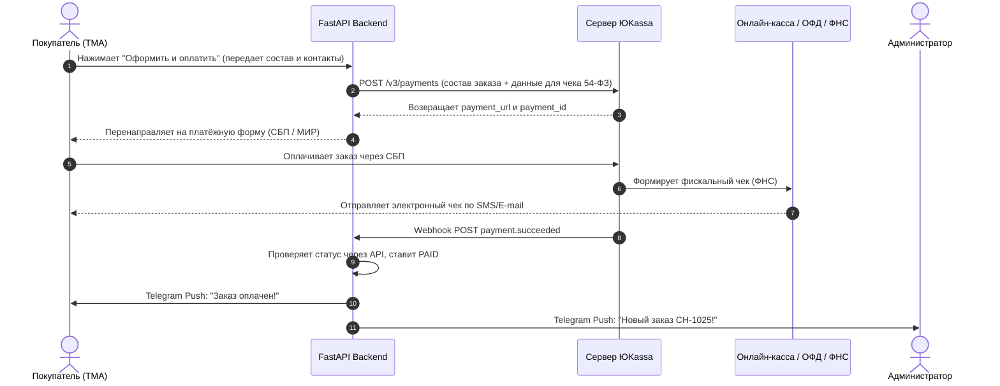

# Приём платежей и фискализация (54-ФЗ, ЮKassa, СБП)

В этом документе детально описана интеграция платёжного шлюза **ЮKassa** для приема оплаты картами МИР, СБП и SberPay с автоматической фискализацией кассовых чеков по требованиям **54-ФЗ**.

---

## 1. Схема движения средств и чеков



---

## 2. Формирование фискального чека (54-ФЗ) в ЮKassa

Каждый платёжный запрос обязан содержать объект `receipt` с позициями заказа и ставкой налога.

### Параметры позиций чека (тег 1059):
* `customer`: e-mail или телефон покупателя (куда отправлять электронный чек).
* `items`: массив купленных позиций:
  * `description`: наименование товара (до 128 символов);
  * `quantity`: количество;
  * `amount`: стоимость позиции;
  * `vat_code`: код ставки НДС:
    * `1` — без НДС (для ИП на УСН «Доходы», Патенте и плательщиков НПД);
    * `2` — НДС 0%;
    * `4` — НДС 20%;
  * `payment_mode`: `full_payment` (полная предоплата в момент заказа);
  * `payment_subject`: `commodity` (товар) для свечей/диффузоров и `service` (услуга) для строки доставки.

---

## 3. Сервис создания платежа на Python

Файл: `backend/app/services/yookassa_service.py`

```python
import uuid
import httpx
from decimal import Decimal
from app.core.config import settings
from app.db.models import Order, DeliveryType

YOOKASSA_API_URL = "https://api.yookassa.ru/v3/payments"

async def create_yookassa_payment(order: Order) -> tuple[str, str]:
    """
    Создает платежную сессию в ЮKassa с позициями чека по 54-ФЗ.
    Возвращает: (confirmation_url, payment_id)
    """
    idempotence_key = str(uuid.uuid4())
    auth = (settings.YOOKASSA_SHOP_ID, settings.YOOKASSA_SECRET_KEY)

    # 1. Формируем позиции для электронного кассового чека (54-ФЗ)
    receipt_items = []
    
    # Товары
    for item in order.items:
        receipt_items.append({
            "description": item.title_snapshot[:128],
            "quantity": f"{item.quantity}.000",
            "amount": {
                "value": f"{item.unit_price:.2f}",
                "currency": "RUB"
            },
            "vat_code": 1, # 1 = Без НДС (УСН/Патент/НПД)
            "payment_mode": "full_payment",
            "payment_subject": "commodity"
        })

    # Доставка отдельной строкой, если платная
    if order.delivery_cost > Decimal("0.00"):
        receipt_items.append({
            "description": "Доставка заказа",
            "quantity": "1.000",
            "amount": {
                "value": f"{order.delivery_cost:.2f}",
                "currency": "RUB"
            },
            "vat_code": 1,
            "payment_mode": "full_payment",
            "payment_subject": "service"
        })

    # 2. Формируем тело запроса к ЮKassa
    payload = {
        "amount": {
            "value": f"{order.total_amount:.2f}",
            "currency": "RUB"
        },
        "capture": True, # Автоматическое безакцептное списание
        "confirmation": {
            "type": "redirect",
            "return_url": f"{settings.MINI_APP_URL}/order-success?order_id={order.id}"
        },
        "description": f"Оплата заказа {order.order_number} в Candela Home",
        "metadata": {
            "order_id": str(order.id),
            "order_number": order.order_number,
            "user_id": str(order.user_id)
        },
        "receipt": {
            "customer": {
                "email": order.delivery_details.get("recipient_email"),
                "phone": order.delivery_details.get("recipient_phone")
            },
            "items": receipt_items
        }
    }

    headers = {
        "Idempotence-Key": idempotence_key,
        "Content-Type": "application/json"
    }

    async with httpx.AsyncClient(timeout=10.0) as client:
        response = await client.post(YOOKASSA_API_URL, json=payload, auth=auth, headers=headers)
        if response.status_code != 200:
            raise Exception(f"YooKassa error: {response.text}")

        res_data = response.json()
        payment_id = res_data["id"]
        confirmation_url = res_data["confirmation"]["confirmation_url"]
        return confirmation_url, payment_id

async def verify_yookassa_status(payment_id: str) -> bool:
    """Встречная проверка статуса платежа для защиты от поддельных вебхуков"""
    auth = (settings.YOOKASSA_SHOP_ID, settings.YOOKASSA_SECRET_KEY)
    async with httpx.AsyncClient(timeout=10.0) as client:
        res = await client.get(f"{YOOKASSA_API_URL}/{payment_id}", auth=auth)
        if res.status_code == 200:
            data = res.json()
            return data.get("status") == "succeeded"
    return False
```

---

## 4. Чек-лист перехода от тестирования к боевым платежам

1. **Тестовый режим (Sandbox)**:
   * Проверить создание заказа на тестовых ключах `test_...`.
   * Использовать тестовые карты ЮKassa (`1111 1111 1111 1026`, CVC `000`).
   * Убедиться, что статус меняется на `PAID`, остатки списываются, а бот присылает сообщение.
2. **Боевой режим (Production)**:
   * Заключить договор с ЮKassa (как Самозанятый или ИП).
   * Подключить облачную онлайн-кассу в личном кабинете ЮKassa (или активировать автоматические чеки для самозанятых через «Мой налог»).
   * Указать в вебхуках боевой URL: `https://your-domain.ru/api/v1/payments/webhook`.
   * Заменить боевые ключи `live_...` в `.env` на сервере.
   * Совершить тестовую покупку реальной картой на 100 рублей и проверить получение фискального чека на e-mail.
